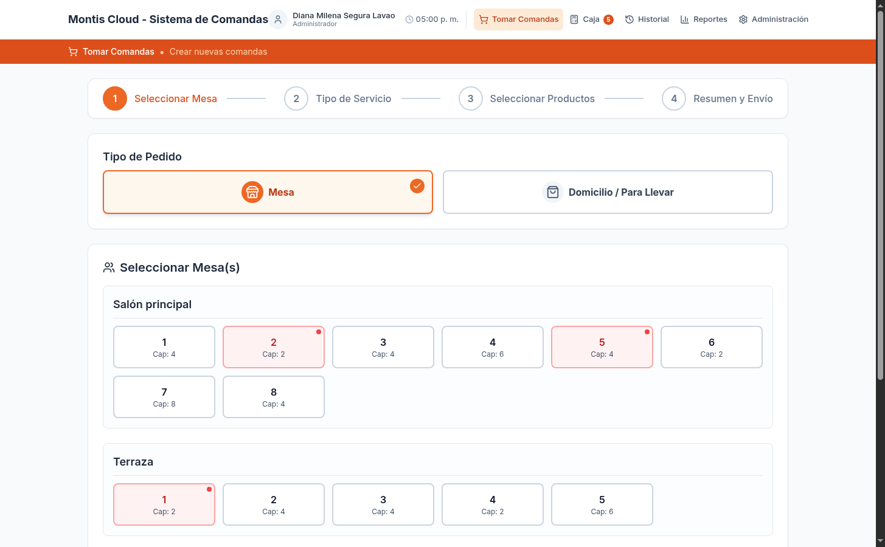
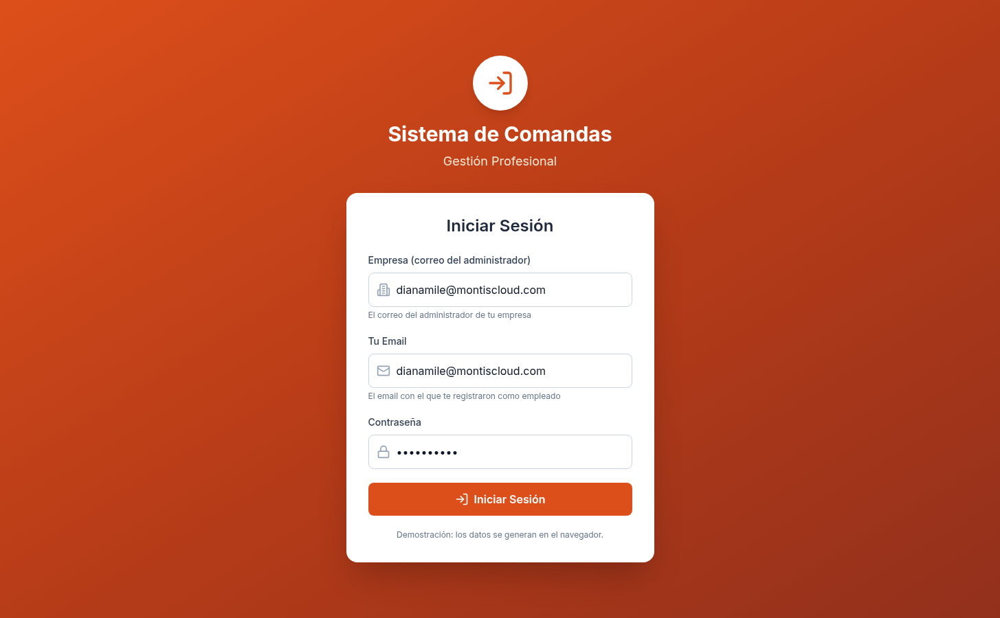
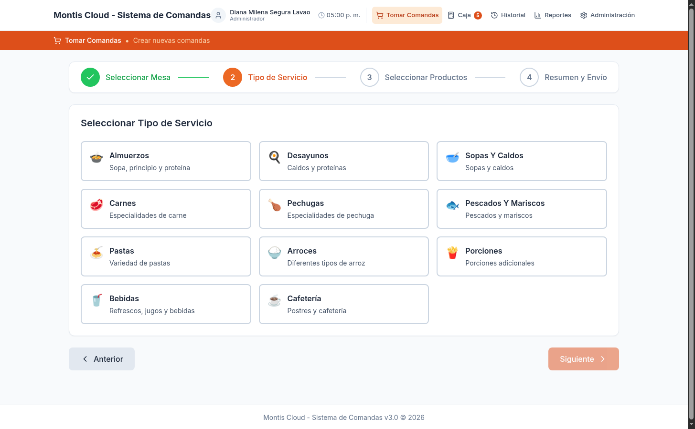
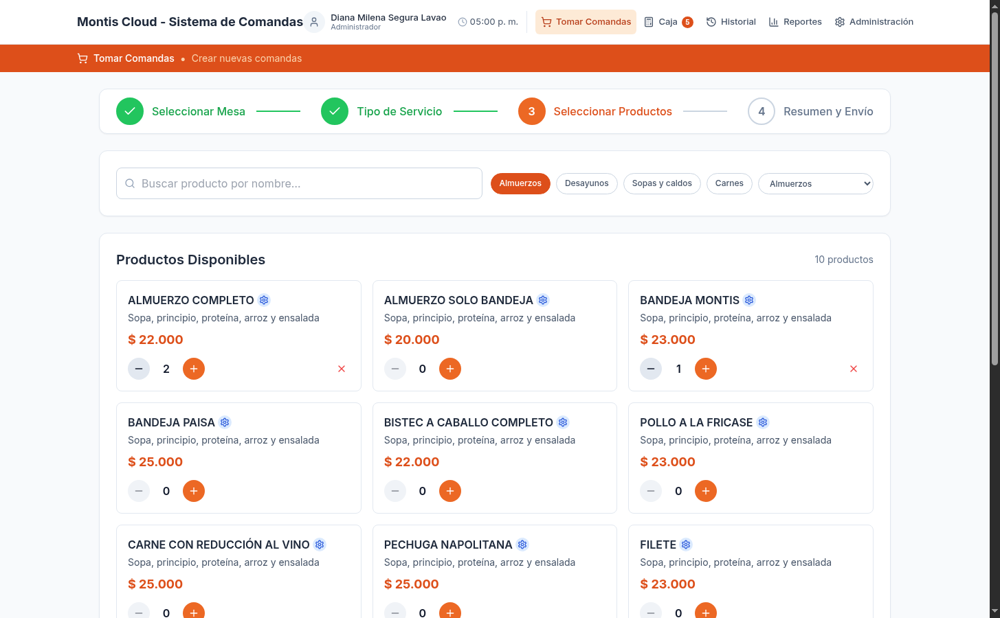
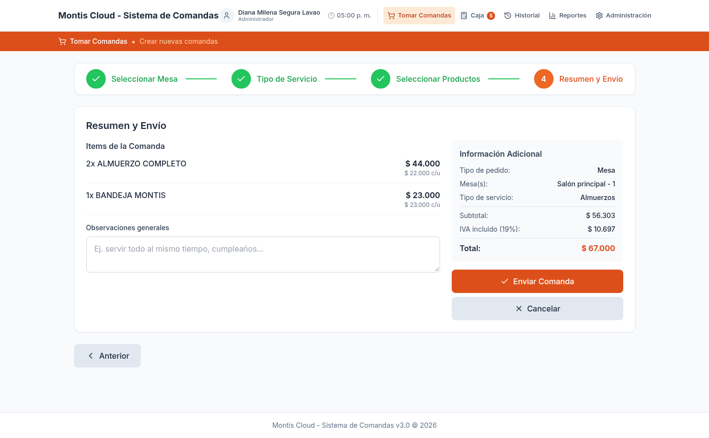
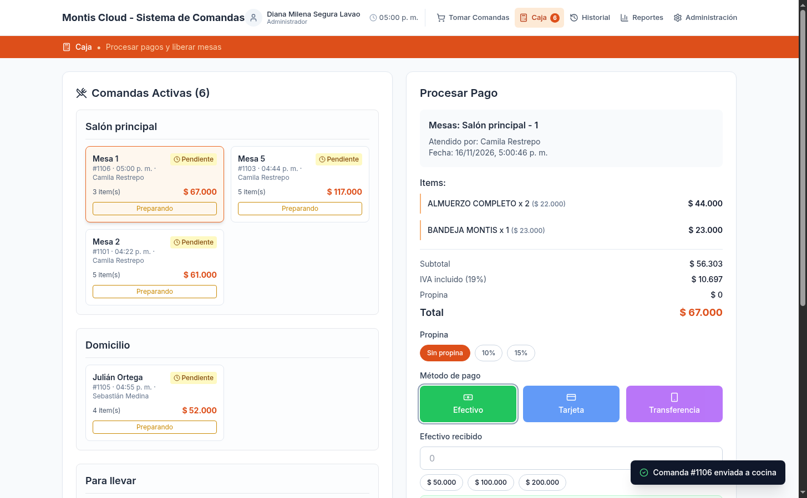
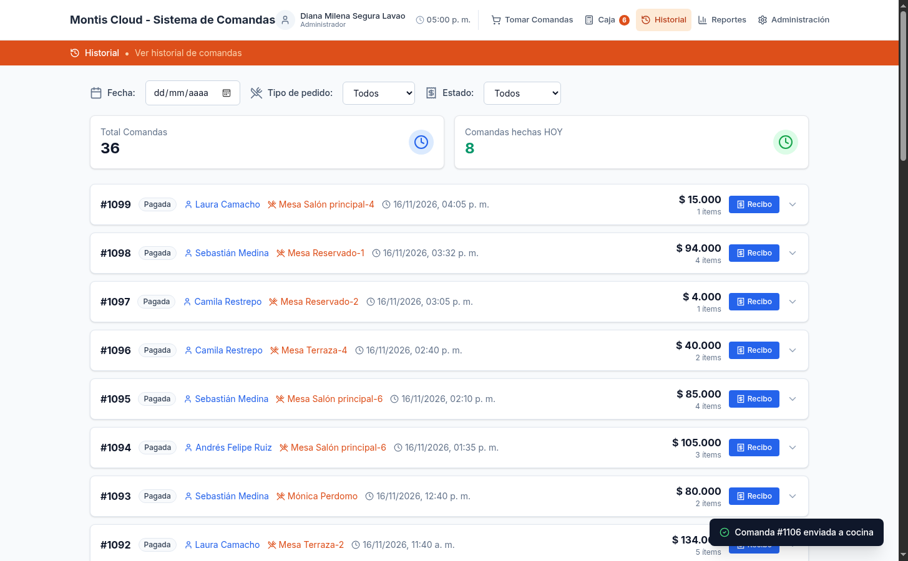
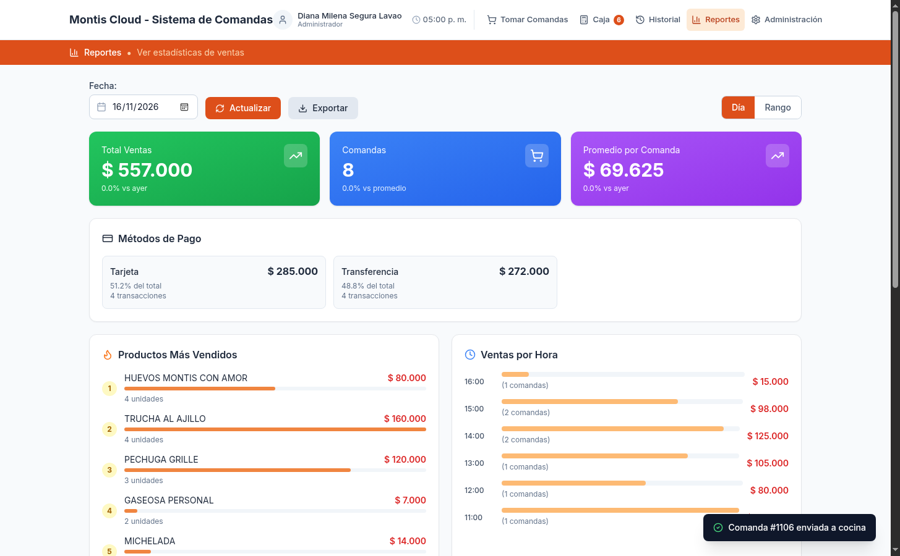
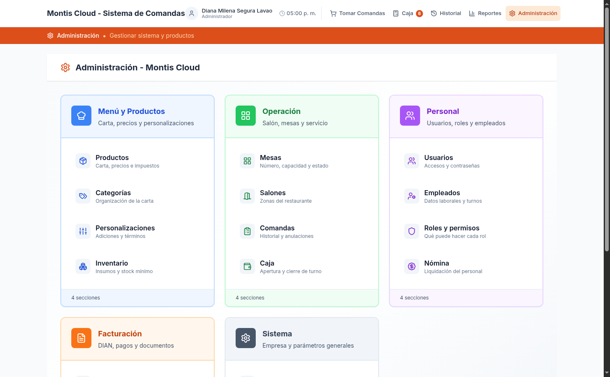

# Montis Cloud - Sistema de Comandas

Interfaz del sistema de comandas para restaurantes **Montis Cloud**: toma de comandas,
caja, historial, reportes y administración.

> **Versión de demostración.** Este repositorio contiene únicamente la interfaz y los
> datos de ejemplo que la alimentan. Todo se genera en memoria dentro del navegador:
> no hay backend, base de datos ni servicios externos. La lógica de negocio, la
> integración con impresión, facturación electrónica y el API quedan fuera de este
> repositorio.



## Módulos

| Módulo | Qué se puede hacer |
| --- | --- |
| **Tomar Comandas** | Asistente de 4 pasos: mesa o domicilio, tipo de servicio, productos con personalizaciones y resumen antes de enviar a cocina. |
| **Caja** | Comandas abiertas agrupadas por salón, estados de preparación y cobro con efectivo, tarjeta o transferencia (con propina y cálculo de cambio). |
| **Historial** | Filtros por fecha, tipo de pedido y estado; detalle desplegable de cada comanda. |
| **Reportes** | Ventas del día, ticket promedio, métodos de pago, productos más vendidos, ventas por hora y por categoría. |
| **Administración** | Mapa de módulos del sistema (productos, mesas, personal, facturación, configuración) como referencia visual. |

## Capturas

| | |
| --- | --- |
|  |  |
|  |  |
|  |  |
|  |  |



## Stack

- **React 18** + **TypeScript**
- **Vite** (servidor de desarrollo y build)
- **Tailwind CSS** con la paleta corporativa (naranja `#ec6824` / slate)
- **lucide-react** para iconografía

## Ejecutar en local

```bash
npm install
npm run dev
```

La aplicación queda en `http://localhost:4173`.

Para generar la versión de producción:

```bash
npm run build
npm run preview
```

## Estructura

```
src/
├── components/          # Layout (header + barra de módulo), login y UI base
│   └── ui/Modal.tsx
├── data/
│   ├── menu.ts          # Carta de ejemplo (productos, precios y grupos de personalización)
│   ├── salones.ts       # Salones, mesas y meseros
│   └── comandas.ts      # Comandas abiertas e historial de los últimos días
├── store/
│   └── demo-store.tsx   # Estado en memoria: crear comanda, cobrar y liberar mesa
├── types.ts             # Tipos del dominio
├── utils/format.ts      # Moneda, fechas, totales y desglose de IVA
└── views/
    ├── ComandasView.tsx      # Asistente de 4 pasos
    ├── CajaView.tsx          # Comandas activas y cobro
    ├── HistorialView.tsx     # Historial con filtros
    ├── ReportesView.tsx      # Indicadores de ventas
    └── AdministracionView.tsx
```

## Cómo funciona la demostración

- Los datos se siembran al cargar la aplicación (`src/data`). Las horas se calculan
  respecto al momento de abrir el navegador, de modo que siempre hay comandas
  "en curso" y ventas del día.
- Al confirmar una comanda, esta aparece en **Caja** y ocupa su mesa en el paso 1.
- Al cobrarla, pasa al **Historial** y se refleja en los **Reportes**.
- Al recargar la página, el estado vuelve a su punto de partida.

## Notas

- Los precios están en pesos colombianos (COP) e incluyen IVA del 19 %, que se
  desglosa de forma informativa en el resumen y en el cobro.
- La carta de ejemplo corresponde a la operación de Casa Montis.
- Los módulos de administración se muestran como referencia de la interfaz; no
  editan datos en esta versión.
